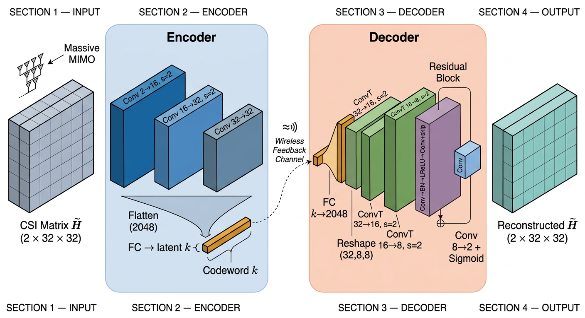
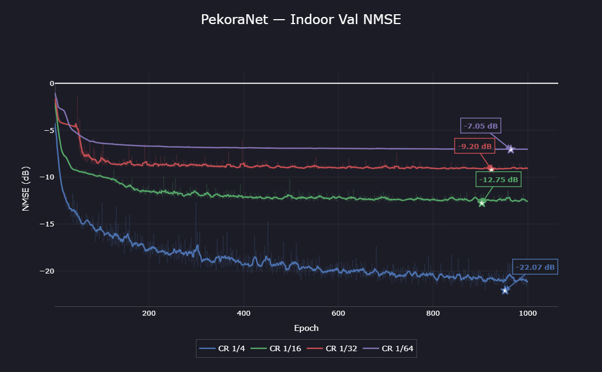
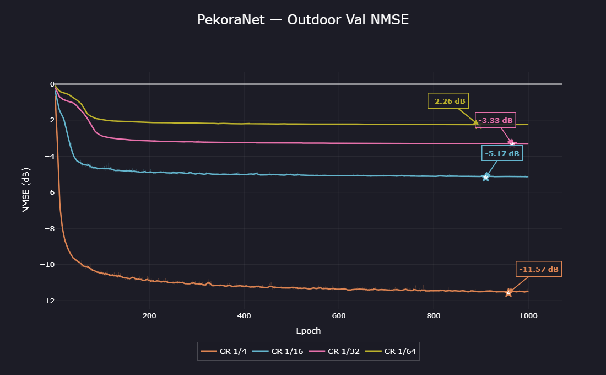
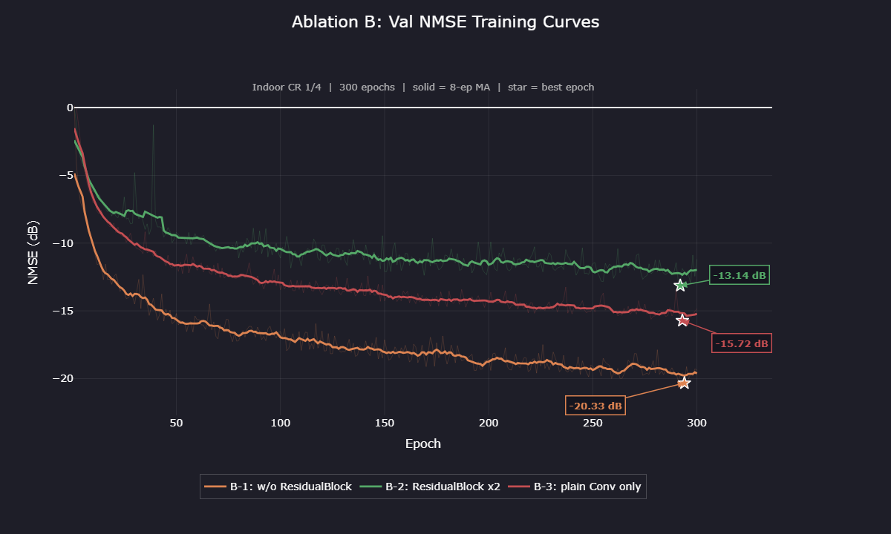

# PekoraNet

> A Lightweight Hierarchical CNN Framework for CSI Feedback Compression in Massive MIMO Systems

---

# Overview

PekoraNet🐇 is a lightweight deep learning framework designed to reduce CSI (Channel State Information) feedback overhead in massive MIMO systems.

Unlike conventional CSI compression methods that rely heavily on shallow fully-connected architectures, PekoraNet introduces:

- Hierarchical CNN-based feature extraction
- Residual reconstruction refinement
- Spatial redundancy-aware compression
- Stable low-compression-ratio reconstruction

The model is specifically designed for:

- practical deployment feasibility
- lightweight inference
- robust reconstruction under aggressive compression ratios

---

# PekoraNet Architecture



---

# Key Features

## Hierarchical CSI Compression

```text
CSI Tensor
 → CNN Feature Extraction
 → Hierarchical Downsampling
 → Latent Compression
```

---

## Residual Reconstruction Refinement

Advantages:

- improved gradient flow
- stable convergence
- better high-frequency channel reconstruction
- lower NMSE degradation

---

## Lightweight Architecture

Designed for realistic UE-side deployment:

- low parameter count
- moderate FLOPs
- stable training
- practical inference latency

---

## Stable Training Pipeline

PekoraNet includes several modern training stabilization techniques:

- AdamW optimizer
- CosineAnnealingLR scheduler(not use yet)
- Gradient clipping
- Mixed Precision Training (AMP)
- BatchNorm
- LeakyReLU activation

---

# Architecture

## Encoder

```python
Conv2d(2 → 16, stride=2)
Conv2d(16 → 32, stride=2)
Conv2d(32 → 32)
Flatten
Linear → latent_dim
```

---

## Decoder

```python
Linear(latent_dim → feature map)
ConvTranspose2d
ConvTranspose2d
ResidualBlock
Conv2d → reconstructed CSI
```

---

# Motivation

CSI feedback overhead becomes a critical bottleneck in massive MIMO systems.

Existing approaches such as CsiNet suffer from:

- shallow feature extraction
- unstable low-CR reconstruction
- weak spatial hierarchy modeling
- limited practical deployment considerations

PekoraNet addresses these limitations through hierarchical CNN compression and residual reconstruction refinement.

---

# Compression Ratios

Supported compression ratios:

- CR = 1/4
- CR = 1/8 (not use yet)
- CR = 1/16
- CR = 1/32
- CR = 1/64

---

# Dataset

```python
scenario = "indoor"
scenario = "outdoor"
scenario = "joint(not use yet)"
```

---

# Training

```bash
python train.py \
  --scenario indoor \
  --cr 1/32 \
  --epochs 1000 \
  --amp \
  --scheduler (cosine, etc)
```

---

# Evaluation Metrics

- NMSE (Normalized Mean Square Error)
- Cosine Similarity (ρ)
- Reconstruction Loss

---

# Experimental Results

## Indoor Validation NMSE



## Outdoor Validation NMSE



## Current PekoraNet Performance

| Scenario | Compression Ratio | NMSE (dB) | Cosine Similarity (ρ) |
|---|---|---:|---:|
| Indoor | 1/4 | **-22.067** | 0.99698 |
| Indoor | 1/16 | -12.749 | 0.97305 |
| Indoor | 1/32 | -9.199 | 0.93586 |
| Indoor | 1/64 | -7.048 | 0.89288 |
| Outdoor | 1/4 | **-11.566** | 0.96455 |
| Outdoor | 1/16 | -5.169 | 0.82977 |
| Outdoor | 1/32 | -3.329 | 0.72377 |
| Outdoor | 1/64 | -2.259 | 0.62579 |

---

# Ablation Study

## Ablation B: Decoder Structure Analysis



### Ablation B Results

| Decoder Variant | Best NMSE | Best Epoch | Note |
|---|---:|---:|---|
| Base (RB ×1) | **-22.07 dB** | ~964 | 1000 epoch result |
| B-1: w/o ResidualBlock | -20.33 dB | 294 | -1.74 dB degradation |
| B-2: ResidualBlock ×2 | -13.14 dB | 292 | severe degradation |
| B-3: plain Conv only | -15.72 dB | 293 | learned upsampling removed |

### Key Observations

- Removing the ResidualBlock still preserves reasonable reconstruction performance.
- Increasing refinement depth with ResidualBlock ×2 significantly degrades convergence stability.
- Replacing ConvTranspose-based learned upsampling with plain convolution causes major NMSE degradation.

The combination of a single ResidualBlock and ConvTranspose2d provides the best reconstruction performance and training stability.

---

# Comparison with CsiNet

| Metric | CsiNet | PekoraNet |
|---|---|---|
| Indoor 1/4 NMSE | -17.36 dB | **-22.067 dB** |
| Indoor 1/16 NMSE | -8.65 dB | **-12.749 dB** |
| Indoor 1/32 NMSE | -6.24 dB | **-9.199 dB** |
| Indoor 1/64 NMSE | -5.84 dB | **-7.048 dB** |
| Outdoor 1/4 NMSE | -8.75 dB | **-11.566 dB** |
| Outdoor 1/16 NMSE | -4.51 dB | **-5.169 dB** |
| Outdoor 1/32 NMSE | -2.81 dB | **-3.329 dB** |
| Outdoor 1/64 NMSE | -1.93 dB | **-2.259 dB** |

> Note:
> CsiNet reference values are based on the original paper.

---

# Future Work

- Attention-enhanced CSI encoding
- Quantization-aware training
- Adaptive compression ratio support
- Temporal CSI modeling
- Beamforming-aware optimization
- Semantic CSI feedback

---

# Research Direction

PekoraNet aims to bridge the gap between:

```text
high-performance CSI reconstruction
and
practical wireless deployment
```

The framework focuses on:

- robustness
- lightweight design
- deployment feasibility
- stable reconstruction

rather than excessive architectural complexity.

---

# Citation

If you use PekoraNet in your research or projects, please consider citing this repository.

Formal publication information will be added in a future release.

---

# License

MIT License

---

# Acknowledgements

Inspired by:

- CsiNet
- CRNet
- Deep learning-based CSI compression research
- Massive MIMO feedback optimization studies
